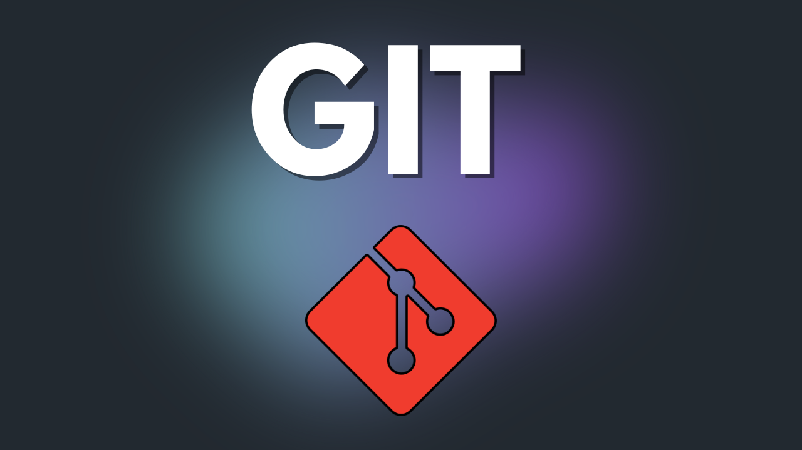
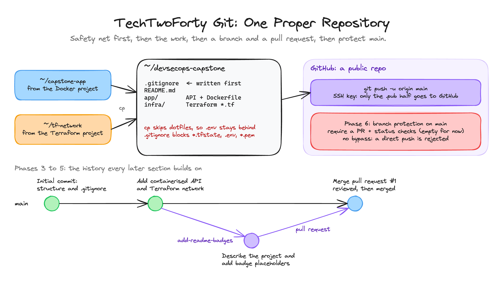

<p align="center">
  
</p>

<h1 align="center">TechTwoForty: Git</h1>
<p align="center"><b>One Proper Repository</b> · the finished project</p>
<p align="center">
  <a href="https://github.com/wjpearce-github/TechTwoForty-Docker">← Previous: Docker</a> ·
  <a href="https://github.com/wjpearce-github/TechTwoForty-Start-Here">Course map</a> ·
  <a href="https://github.com/wjpearce-github/TechTwoForty-CICD">Next: CI/CD →</a>
</p>

> [!TIP]
> **This repo is the finished template for the Git project. Treat it as your cheat sheet.**
> It is what your `devsecops-capstone` repo should look like at the end of the Git project: `.gitignore` committed first, `app/` and `infra/` inside, and a history with one branch merged through a pull request. Look at this repo's own commit history too. It follows the same shape as yours should.

| | |
|---|---|
| **Section** | 6 of 10 · Version control |
| **Time** | About 45 minutes, 6 phases |
| **Runs on** | Git plus a GitHub account. No cloud costs |
| **Deliverable** | A public `devsecops-capstone` repo with your app and infrastructure, a branch-and-PR history, and a protected `main`. Every later section commits into it |

## The big picture



<sub>Drawn in Excalidraw. To edit it, open <code>assets/diagram.excalidraw</code> at <a href="https://excalidraw.com">excalidraw.com</a>.</sub>

## What is in this repo

```text
devsecops-capstone/              (this template repo)
├── .gitignore                   Written FIRST, before any file was added
├── app/                         cp -r ~/capstone-app/*  (the Docker project)
│   ├── app.py
│   ├── requirements.txt
│   ├── test_app.py
│   ├── Dockerfile
│   └── docker-compose.yml
├── infra/                       cp ~/tf-network/*.tf    (the Terraform project)
│   ├── backend.tf
│   ├── main.tf
│   ├── variables.tf
│   └── outputs.tf
└── docs/
    └── example-README.md        What YOUR README.md looks like after Phase 5
```

> [!NOTE]
> Your own repo has `README.md` where this one has `docs/example-README.md`. The template uses its front page for this cheat sheet instead.

**Notice what is not here.** `cp -r ~/capstone-app/*` skips files whose names start with a dot, so `.env` (and its password) stayed behind, along with `.dockerignore`. `*.tf` copies the code but none of Terraform's working files. The `.gitignore` is the backstop.

## The history you should end up with

```text
*   Merge pull request #1 from yourname/add-readme-badges
|\
| * Describe the project and add badge placeholders
|/
* Add containerised API and Terraform network
* Initial commit: project structure and gitignore
```

Run `git log --oneline --graph` on this repo to see the same shape (plus one last commit that adds this cheat sheet).

## Cheat sheet, phase by phase

### Phase 1 · Identity and access

```bash
git config --global user.name "Your Name" && git config --global user.email "you@example.com" && git config --global init.defaultBranch main
ssh-keygen -t ed25519 -C "you@example.com" && cat ~/.ssh/id_ed25519.pub
ssh -T git@github.com        # Hi yourname! You've successfully authenticated.
```

Only ever share the `.pub` half. The private half stays on your machine, like a password.

### Phase 2 · The safety net first

```bash
mkdir devsecops-capstone && cd devsecops-capstone && git init && mkdir app infra
code .gitignore
cp -r ~/capstone-app/* app/ && cp ~/tf-network/*.tf infra/ && ls app infra
```

The finished [`.gitignore`](.gitignore) blocks `.env`, `*.pem`, `.venv/`, `__pycache__/`, `*.tfstate`, `*.tfstate.*`, `.terraform/` and `terraform.tfvars`.

### Phase 3 · The core loop

```bash
git status
printf '# DevSecOps Capstone\n' > README.md && git add .gitignore README.md && git commit -m "Initial commit: project structure and gitignore"
git add app/ infra/ && git commit -m "Add containerised API and Terraform network" && git log --oneline
```

### Phase 4 · Push to GitHub
New repository, named `devsecops-capstone`, **Public** (branch protection is only free on public repos), and **empty**: no README, no .gitignore, no licence.

```bash
git remote add origin git@github.com:yourname/devsecops-capstone.git && git push -u origin main
```

### Phase 5 · Work like a team

```bash
git switch -c add-readme-badges
# edit README.md: a line describing the project, and a placeholder for badges
git add README.md && git commit -m "Describe the project and add badge placeholders" && git push -u origin add-readme-badges
# GitHub: Pull requests, New, base main, compare add-readme-badges. Read the diff, then Merge
git switch main && git pull
```

### Phase 6 · Protect main

GitHub, Settings, Branches, **Add classic branch protection rule**, pattern `main`:

| Setting | Value |
|---|---|
| Require a pull request before merging | ✔ ticked |
| Require approvals | ✘ **unticked** (you cannot approve your own PR) |
| Require status checks to pass before merging | ✔ ticked, list **empty for now** |
| Do not allow bypassing the above settings | ✔ ticked, so the rules apply to you too |

Prove it, then clean up:

```bash
echo test >> README.md && git commit -am "Direct push test" && git push   # rejected: protected branch hook declined
git reset --hard origin/main
```

## Final handover check

- [ ] `devsecops-capstone` is on GitHub with `app/` and `infra/` inside
- [ ] `.gitignore` was committed first and excludes state files and `.env`
- [ ] History shows a branch merged through a pull request
- [ ] `main` is protected and a direct push is refused

## Common mistakes

| Mistake | What happens | The fix |
|---|---|---|
| Adding files before `.gitignore` exists | A secret or state file can slip into history | Safety net first, always |
| `cp: No such file or directory` | `~/capstone-app` or `~/tf-network` is missing | Do the Docker or Terraform project first, or move the folder to your home |
| Creating the GitHub repo with a README | The first push is rejected (unrelated histories) | Create it empty |
| Leaving "Require approvals" ticked | You can never merge your own PR | Untick it |
| Leaving bypass allowed | You, the owner, can push straight past every rule | Tick "Do not allow bypassing" |

## What you can now do

- **Repository hygiene:** a safety-net `.gitignore` written before any files
- **The core workflow:** status, add, commit, push, with messages that explain why
- **Team workflow:** branches and pull requests, even when working alone
- **Branch protection:** rules that enforce the workflow instead of relying on discipline

The empty required-checks box is waiting for the pipeline you build in CI/CD.

---

<p align="center">
  <b>TechTwoForty</b> · Git · 6 of 10<br>
  <a href="https://github.com/wjpearce-github/TechTwoForty-Docker">← Previous: Docker</a> ·
  <a href="https://github.com/wjpearce-github/TechTwoForty-Start-Here">Course map</a> ·
  <a href="https://github.com/wjpearce-github/TechTwoForty-CICD">Next: CI/CD →</a>
</p>
